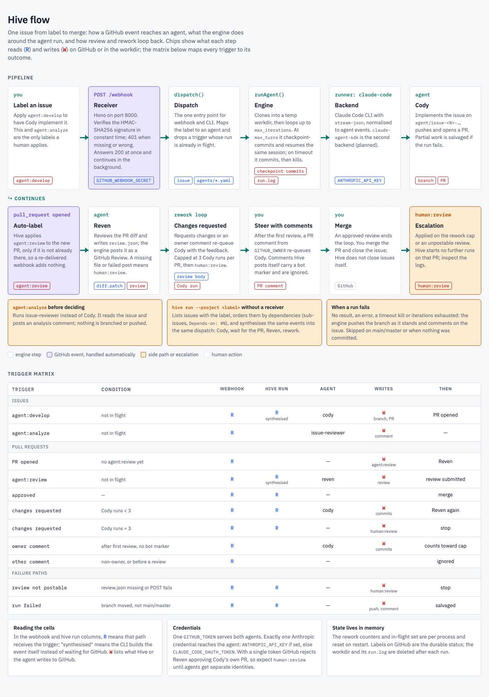
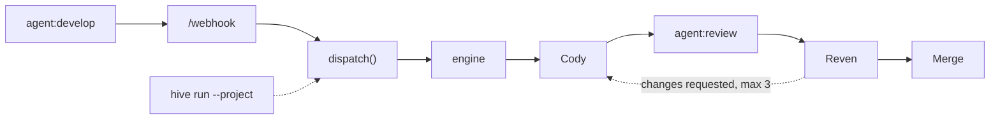

# Hive

A personal tool to run AI coding agents against GitHub issues and PRs, triggered by labels and comments (via a webhook receiver or the `hive run` CLI).

Primary use case: add the label `agent:develop` to a GitHub issue, a remote agent reads it, implements the change and opens a PR for review.

> Status: the TypeScript rewrite is the documented path. The Python package under `hive/` still exists in the tree but is neither documented nor containerised any more. Nothing in this README has been verified end-to-end yet; real webhook and `hive run` runs against GitHub, and the Docker image, are pending a human check.

---

## How it works

[](https://giorgiogalassi.github.io/hive/flow.html)

The full picture, including the side paths, the failure paths and a matrix
of which trigger leads to which run, lives in
[`docs/flow.html`](docs/flow.html), rendered at
<https://giorgiogalassi.github.io/hive/flow.html>. The spine is:



The webhook and `hive run` share the same dispatch function, so a label behaves identically whichever way it arrives.

---

## Project structure

```
src/
  agents/       YAML loader and schema validation
  backends/     agent runners (claude-code CLI shell-out; claude-agent-sdk)
  cli/          Commander CLI (run, list; deploy/remove are stubs), layered .env
  dispatch/     HiveEvent, dispatch, rework loop, in-flight dedup
  engine/       iteration loop, idle detection, event schema, backend registry
  runtime/      shared DispatchDeps factory
  vcs/          VcsPort and GitHub adapter
  webhook/      Hono app and entry point
  workspace/    git workspace (clone, branch, checkpoint, salvage)
agents/         agent YAML definitions (authoritative)
Dockerfile  docker-compose.yml  .env.example
hive/           legacy Python implementation (not documented, not containerised)
```

---

## Requirements

- Node.js 24 and pnpm 10 (pnpm is pinned in `package.json`; `corepack enable` provides it)
- `git` on PATH
- The Claude Code CLI on PATH for `runner: claude-code` (`npm install -g @anthropic-ai/claude-code`)
- A GitHub repo with webhook access and a token (see Environment variables)
- An Anthropic credential (see Credentials)
- Docker + Docker Compose, only if you run the receiver in a container

Python is not required.

---

## Install

```bash
corepack enable
pnpm install
pnpm build
```

To get the `hive` command on your PATH:

```bash
pnpm link --global
hive --help
```

Without linking, use `node dist/cli/index.js <command>`.

---

## Setup

**1. Configure the environment**

```bash
cp .env.example .env
```

Fill in at least:

```
GITHUB_WEBHOOK_SECRET=your-secret-here
GITHUB_TOKEN=your-github-pat
GITHUB_OWNER=your-github-username
ANTHROPIC_API_KEY=your-anthropic-key
```

**2. Start the receiver**

With Docker (listens on port 8000, reads `.env` through Compose `env_file`):

```bash
docker compose up --build
```

Or locally:

```bash
node --env-file=.env dist/webhook/main.js   # built; loads .env
pnpm start                                  # same entry, variables must already be in the shell
pnpm dev                                    # tsx, no build step
```

The receiver refuses to start without `GITHUB_WEBHOOK_SECRET`. `PORT` defaults to 8000.

**3. Expose localhost**

```bash
npx localtunnel --port 8000
```

This prints a public HTTPS URL. The URL changes whenever the tunnel restarts; update the GitHub webhook when that happens.

**4. Configure the GitHub webhook**

Repo -> Settings -> Webhooks -> Add webhook:

| Field | Value |
|---|---|
| Payload URL | `https://your-tunnel-url/webhook` |
| Content type | `application/json` |
| Secret | same value as `GITHUB_WEBHOOK_SECRET` |
| Events | Issues, Pull requests, Issue comments, Pull request reviews |

A request with a missing or invalid `X-Hub-Signature-256` gets 401; a valid one gets 200.

**5. Trigger an agent**

Apply the label `agent:develop` to an issue. The run continues in the background after the webhook responds.

---

## `hive run` - batch execution

```bash
hive run --project <label>
hive run --project my-feature --repo owner/repo
```

Fetches every open issue carrying `<label>`, resolves the dependency order written at issue-creation time (a first-line `Blocked by:`), and runs Cody then Reven per issue, sequentially, through the same dispatch as the webhook. There is no LLM orchestrator at runtime.

`GITHUB_TOKEN` is required. Repository resolution order:

1. `--repo` flag
2. `GITHUB_REPO` environment variable
3. `git remote get-url origin` of the current directory

Other commands: `hive list`. `hive deploy` and `hive remove` are stubs that exit 0.

**Machine-level secrets (recommended one-time setup):**

```bash
mkdir -p ~/.hive
printf 'GITHUB_TOKEN=ghp_your_token_here\nANTHROPIC_API_KEY=your_key_here\n' > ~/.hive/.env
chmod 600 ~/.hive/.env
```

---

## Label model

Labels are owned by the orchestrator except for the manual entry points. Steering mid-flight happens through PR comments, not labels.

| Label | Applied by | Meaning |
|---|---|---|
| `agent:analyze` | Human | Analyze an issue before deciding to develop |
| `agent:develop` | Human | Implement a single issue (Cody) |
| `agent:review` | Orchestrator | Reven reviews the PR (applied after Cody opens it) |
| `human:review` | Orchestrator | Agent failed unrecoverably; a human must inspect logs |

---

## Agent YAML format

```yaml
name: issue-reviewer
runner: claude-code          # claude-code | claude-agent-sdk
model:
  provider: anthropic
  name: claude-sonnet-4-6
  max_turns: 20
  max_iterations: 1
  timeout: 900
  idle_timeout: 300
triggers:
  - type: github-label
    label: "agent:analyze"
system_prompt: |
  You are a senior software engineer...
```

Add an agent by dropping a `.yaml` file in `agents/`. Any `runner` value other than the two above fails at load, listing the known ones.

- `claude-code`: spawns the Claude Code CLI (`claude --print --output-format stream-json`) and resumes sessions with `--resume`.
- `claude-agent-sdk`: uses `@anthropic-ai/claude-agent-sdk`. The SDK wraps a Claude Code subprocess (a bundled binary, overridable with `HIVE_CLAUDE_CODE_PATH`); it does not remove the subprocess. This is the second runner and lands in a separate step from the CLI backend, so it may not be available in your checkout yet.

The engine owns the iteration loop, idle and overall timeouts and checkpoint commits for both, so `max_turns` is a per-iteration valve and `max_iterations` is what bounds a long task.

---

## Credentials

Hive passes exactly one Anthropic credential to the agent process, for either runner:

1. If `ANTHROPIC_API_KEY` is set, it is used and `CLAUDE_CODE_OAUTH_TOKEN` is stripped from the child environment.
2. Otherwise `CLAUDE_CODE_OAUTH_TOKEN` is used.

`ANTHROPIC_API_KEY` is the default, and the credential to use for the SDK backend. `CLAUDE_CODE_OAUTH_TOKEN` (from `claude setup-token`) is a personal-use option only; do not rely on it for shared or unattended deployments. `GITHUB_TOKEN` is injected into the agent environment as well.

---

## Environment variables

| Variable | Required | Description |
|---|---|---|
| `GITHUB_WEBHOOK_SECRET` | Webhook receiver | HMAC secret shared with the GitHub webhook |
| `GITHUB_TOKEN` | Yes | PAT: clone, push, comments, labels, PRs, reviews. Needs write on Contents, Issues and Pull requests |
| `ANTHROPIC_API_KEY` | Yes, unless OAuth token set | Default Anthropic credential; wins over the OAuth token |
| `CLAUDE_CODE_OAUTH_TOKEN` | No | Personal-use alternative; used only when `ANTHROPIC_API_KEY` is unset |
| `HIVE_CLAUDE_CODE_PATH` | No | Claude Code executable for the SDK backend, overriding the bundled binary (read once the SDK backend lands) |
| `GITHUB_OWNER` | Yes | GitHub username of the repo owner; identifies owner comments that re-queue Cody |
| `GITHUB_REPO` | No | Target repo for `hive run` in `owner/repo` form (auto-detected if unset) |
| `PORT` | No | Receiver port (default 8000) |

---

## Layered env resolution (CLI)

The `hive` CLI runs from arbitrary project directories, so it resolves variables in layers.

| Layer | Source | Typical contents |
|---|---|---|
| 1 (wins) | process environment / shell exports | CI secrets, manual exports |
| 2 | `.env` in the current working directory | `GITHUB_OWNER`, `GITHUB_REPO` |
| 3 | `~/.hive/.env` | `GITHUB_TOKEN`, `ANTHROPIC_API_KEY` |

Existing values are never overwritten by a file, and a cwd `.env` beats `~/.hive/.env`. Missing files are skipped.

> The webhook receiver does not layer. Under Docker it reads the repo-root `.env` via `env_file`; locally it reads the process environment.

---

## Development

```bash
pnpm dev       # receiver via tsx
pnpm build     # tsc
pnpm test      # vitest
```

Engine design and sequencing: see the "Engine track" section of `PLAN.md`.

---

## Debugging

```bash
docker compose logs -f                     # follow logs
docker compose logs --tail 50              # recent logs
docker compose exec app bash               # shell in the container
docker compose exec app claude --version   # CLI present?
docker compose exec app claude --print "say hello in one sentence"   # credential works?
docker compose exec app ps aux             # running processes
docker compose down && docker compose up --build   # clean rebuild
```

Each run writes a structured `run.log` (backend payloads nested under `extra`).
